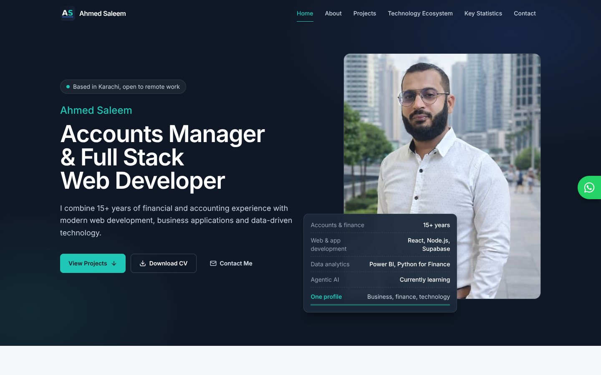
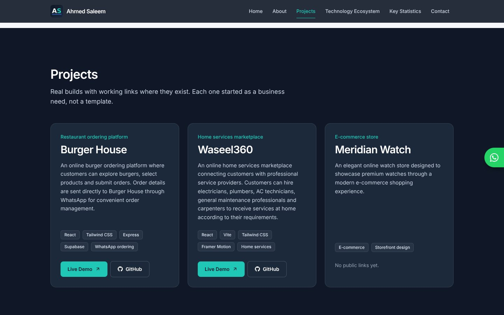

# Ahmed Saleem | Portfolio

Personal portfolio of **Ahmed Saleem**, an Accounts Manager with 15+ years in finance and accounting, and a full stack web and app developer (NextGenzCoder). Built with Next.js, Tailwind CSS and Framer Motion.

**Live site:** https://nextgenzcoder.vercel.app




## What's on the site

- **Hero** with a short introduction, Download CV, View Projects and Contact buttons
- **About** with a professional experience timeline, education (newest first) and additional courses, with completed courses and ongoing learning kept separate
- **Projects**: three featured builds (Burger House, Waseel360, Meridian Watch) plus earlier work, with GitHub and live-demo links where they exist
- **Technology ecosystem**: skills grouped by area (frontend, backend, database and deployment, accounting and finance, data analytics, AI, professional tools), listed as skills with no made-up percentages
- **Key statistics** counted from the CV and the project list
- **Contact form** that emails every message to my inbox
- Floating **WhatsApp** button fixed at the right edge of the screen
- Sticky navigation with active-section highlight and a mobile menu
- SEO: metadata, Open Graph image, JSON-LD (Person and WebSite), sitemap, robots, canonical URL
- Accessible and reduced-motion friendly, responsive from phone to desktop

## Tech stack

| Area | Tools |
| --- | --- |
| Framework | Next.js (App Router), React, JavaScript |
| Styling | Tailwind CSS 3 |
| Animation | Framer Motion |
| Icons | Lucide React, React Icons |
| Font | Inter (self-hosted via Fontsource) |
| Contact form | Web3Forms |
| Hosting | Vercel |

## Getting started

Requires Node.js 20.9 or newer.

```bash
git clone https://github.com/ahmedsaleemdayala/Portfolio.git
cd Portfolio
npm install
cp .env.example .env      # on Windows: copy .env.example .env
npm run dev
```

Open http://localhost:3000.

### Scripts

| Command | What it does |
| --- | --- |
| `npm run dev` | Start the development server |
| `npm run build` | Create the production build |
| `npm start` | Run the production build locally |

### Environment variables

Create a `.env` file in the project root. It is git-ignored, so it never reaches GitHub.

| Variable | Required | Purpose |
| --- | --- | --- |
| `NEXT_PUBLIC_WEB3FORMS_ACCESS_KEY` | Yes | Access key for the contact form. Messages go to the email the key was created with. |
| `NEXT_PUBLIC_SITE_URL` | Yes | Public URL of the site, used for canonical, Open Graph and sitemap URLs. |
| `NEXT_PUBLIC_GOOGLE_SITE_VERIFICATION` | No | Google Search Console verification token. |

Get a free Web3Forms key at https://web3forms.com by entering the email address that should receive messages.

`NEXT_PUBLIC_` values are read when the site is built. After changing one (locally or on Vercel), restart `npm run dev` or redeploy.

## How the contact form works

The form validates the fields in the browser (name, email, subject, message), blocks double submits while sending, and posts to Web3Forms, which emails the message to my inbox. A hidden honeypot field catches simple bots. The success message appears only after Web3Forms confirms delivery, and any failure shows an error with email and WhatsApp as fallbacks.

Web3Forms' free plan only accepts requests from the browser, which is why there is no server route.

## Editing the content

Almost everything lives in one file: [`src/data/site.js`](src/data/site.js). It holds experience, education, courses, projects, skills, statistics and social links. The stats are calculated from the project and experience lists, so they update on their own.

- CV: replace `public/Ahmed_Saleem_CV.pdf` and keep the file name
- Photo: `src/assets/ahmed-saleem.jpg`
- Favicon: `app/icon.png`, `app/apple-icon.png`, `app/favicon.ico`
- Social preview image: `public/og-image.png`

## Project structure

```
app/                  Layout, page, SEO (robots, sitemap) and favicon files
public/               CV (PDF) and Open Graph image
src/
  assets/             Photo and logo mark
  components/         Navbar, Hero, About, Projects, TechEcosystem, Stats,
                      Contact, Footer, WhatsAppButton and shared helpers
  data/site.js        All site content
  lib/validate.js     Contact form validation
docs/                 Screenshots used in this README
```

## Deploying to Vercel

1. Push to the `main` branch. Vercel builds and deploys automatically on every push.
2. In Vercel, open Project Settings, then Environment Variables, and add `NEXT_PUBLIC_WEB3FORMS_ACCESS_KEY` and `NEXT_PUBLIC_SITE_URL`.
3. If you add or change an environment variable, trigger a redeploy so the new value is built in.

## Contact

- Portfolio: https://nextgenzcoder.vercel.app
- Email: ahmedsaleemdayala@gmail.com
- LinkedIn: https://www.linkedin.com/in/ahmed-saleem-31100a382/
- GitHub: https://github.com/ahmedsaleemdayala

All rights reserved. The code is public for reference; please don't reuse my photo, CV or personal content.
